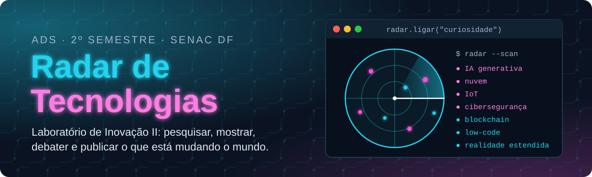

<p align="center">
  
</p>

<p align="center">
  
  
  
  
</p>

<p align="center">
  <b><a href="https://maristelaoliveira.github.io/lab-inovacao-2/">🌐 Abrir o site da disciplina</a></b>
  &nbsp;·&nbsp;
  <b><a href="https://maristelaoliveira.github.io/lab-inovacao-2/#aulas">📚 Ir direto para as aulas</a></b>
  &nbsp;·&nbsp;
  <b><a href="https://maristelaoliveira.github.io/lab-inovacao-2/aulas/aula-06.html">🚀 Oficina de portfólio no GitHub Pages</a></b>
</p>

---

## `>_ radar --scan`

Prazer, eu sou a **Profa. Maristela**, ou só **Stela**! 👋

Boas-vindas ao **Laboratório de Inovação II**, do curso de **Análise e Desenvolvimento de Sistemas** da Faculdade de Tecnologia e Inovação Senac DF (2º semestre, quintas à noite, Taguatinga, 70 horas).

Aqui a gente investiga o que está mudando o mundo. Cada grupo escolhe uma tecnologia, pesquisa com método, apresenta num seminário, ensina num workshop, debate os impactos e publica tudo num portfólio no GitHub Pages: o **Radar de Tecnologias**.

Este repositório é o **site da disciplina**: o lugar onde ficam as aulas, os estudos de caso, as atividades e tudo o que a gente usa no semestre. Nada de slides: aqui a aula é o próprio site.

```text
stela@placa ~/lab2 $ radar --scan
Varrendo o horizonte...  7 sinais encontrados

  ● IA generativa    ● nuvem       ● Internet das Coisas    ● cibersegurança
  ● blockchain       ● low-code    ● realidade estendida

? É moda ou muda a vida das pessoas?
  → pesquisar com método  → checar na fonte  → publicar no Radar
```

> 📸 Curiosidade: a Kodak inventou a câmera digital em 1975. E não lançou, porque vendia filme. Inventar é ter a ideia; inovar é levá-la até as pessoas. (Fonte: IEEE Spectrum.)

---

## 🧭 O que tem no site

| | Seção | Para que serve |
|:-:|---|---|
| 📡 | **O Radar** | O raio-x do tema: inovar ≠ inventar, tipos de inovação, o ciclo do hype e por que a IA precisa de fonte. |
| 📜 | **Ementa e objetivos** | A ementa oficial, palavra por palavra, e aonde a gente quer chegar. |
| 🗺️ | **Quatro unidades** | Inovação, tecnologias atuais e em projeção, seminários e debates, e o portfólio. |
| 📚 | **Aulas** | Uma página por encontro, com conceitos, estudo de caso, atividade e checklist. |
| 📊 | **Avaliação** | Como a nota é montada. Spoiler: não tem prova, a nota vem do Radar. |
| 📖 | **Bibliografia** | Os livros para ir além da aula. |
| ♿ | **Acessibilidade** | Tema claro e escuro, aumento de texto (A+) e botão para pausar as animações. |

---

## 🗺️ A trilha do semestre

Quatro unidades, um radar. Cada unidade acrescenta uma camada ao portfólio do grupo:

```html
<!-- o Radar do grupo, camada por camada -->
<section id="radar">
  <h2>Unidade 1 · Inovação e tecnologia</h2>               <!-- aulas 1 e 2 -->
  <h2>Unidade 2 · Tecnologias atuais e em projeção</h2>    <!-- aulas 3 a 5 e 10 -->
  <h2>Unidade 3 · Seminários, workshops e debates</h2>     <!-- aulas 7, 8 e 11 a 13 -->
  <h2>Unidade 4 · Portfólio de tecnologias</h2>            <!-- aulas 6, 14 e 15 -->
</section>
<p>Status: publicado no GitHub Pages, com fonte em tudo. ✅</p>
```

| Aula | Tema | |
|:-:|---|:-:|
| 01 | Conhecendo o Laboratório de Inovação II | [abrir](https://maristelaoliveira.github.io/lab-inovacao-2/aulas/aula-01.html) |
| 02 | O que é inovação, afinal? | [abrir](https://maristelaoliveira.github.io/lab-inovacao-2/aulas/aula-02.html) |
| 03 | Panorama das tecnologias atuais e em projeção | [abrir](https://maristelaoliveira.github.io/lab-inovacao-2/aulas/aula-03.html) |
| 04 | Pesquisa orientada e uso crítico da IA | [abrir](https://maristelaoliveira.github.io/lab-inovacao-2/aulas/aula-04.html) |
| 05 | Workshop modelo: IA generativa e agentes de IA | [abrir](https://maristelaoliveira.github.io/lab-inovacao-2/aulas/aula-05.html) |
| 06 | Oficina de portfólio no GitHub Pages | [abrir](https://maristelaoliveira.github.io/lab-inovacao-2/aulas/aula-06.html) |
| 07 | Seminários: rodada 1 | [abrir](https://maristelaoliveira.github.io/lab-inovacao-2/aulas/aula-07.html) |
| 08 | Seminários: rodada 2 | [abrir](https://maristelaoliveira.github.io/lab-inovacao-2/aulas/aula-08.html) |
| 09 | Entrega do 1º bimestre: registro no Loop e no README.md | [abrir](https://maristelaoliveira.github.io/lab-inovacao-2/aulas/aula-09.html) |
| 10 | Da tecnologia ao problema real | [abrir](https://maristelaoliveira.github.io/lab-inovacao-2/aulas/aula-10.html) |
| 11 | Mesa de debate: ética, IA e sociedade | em breve |
| 12 | Workshops dos grupos | em breve |
| 13 | Mesa de debate: o futuro do trabalho em TI | em breve |
| 14 | Fichas técnicas do portfólio | em breve |
| 15 | Publicação do portfólio e ensaio da apresentação | em breve |
| 16 | Ajustes finais e ensaio da apresentação | em breve |
| 17 | Apresentação do projeto final | em breve |
| 18 | Avaliação final de recuperação | em breve |

> 🎯 **Problema real:** no 2º bimestre, cada grupo liga a sua tecnologia a um desafio de uma organização do Sistema Fecomércio (Senac, Sesc ou Fecomércio). E as melhores ideias seguem para virar protótipo no [Laboratório de Inovação IV](https://maristelaoliveira.github.io/lab-inovacao-4/).

---

## 🛠️ Ferramentas da disciplina

<p align="center">
  
</p>

| Ferramenta | Para quê |
|---|---|
|  **GitHub Pages** | Publicar o portfólio do grupo, o Radar de Tecnologias. |
| 💻 **VS Code** | Editar os arquivos do portfólio. |
| 📘 **Microsoft Learn** | Trilhas para estudar a tecnologia do grupo. |
| 🎓 **NetAcad** | O curso introdutório do estudo autônomo, ligado à tecnologia do grupo. |
| 🤖 **Copilot do Microsoft 365** | Ajudar na pesquisa e na escrita, com toda informação checada. |
| 💬 **Teams, Loop e Whiteboard** | Combinar, registrar as entregas e trabalhar junto. |
| 🎓 **Moodle** | Entregar as atividades. |

---

## 🤖 IA com consciência

O Copilot do Microsoft 365 ajuda na pesquisa e na escrita, e **toda informação é checada numa fonte de verdade**.

> ⚖️ Em 2023, advogados nos EUA citaram decisões inventadas pelo ChatGPT e foram multados (Mata v. Avianca). Seis processos que nunca existiram. Aqui, toda informação da IA ganha uma fonte.
>
> **Curto-circuito? A fonte confirma, a IA sugere.**

---

## 📊 Como a nota é montada

Dez pontos por bimestre. Aqui não tem prova: a nota vem do Radar.

| 1º bimestre (10 pontos) | | 2º bimestre (10 pontos) | |
|---|:-:|---|:-:|
| Seminários (atividade avaliativa prática) | 4,0 | Apresentação final do Radar de Tecnologias | 7,0 |
| Entregas com explicação no Loop e no README.md | 6,0 | Avaliação Integrada | 2,0 |
| | | Participação na Jornada Interdisciplinar | 1,0 |

Para ser aprovado: **média final 6,0** e pelo menos **75% de frequência**.

```text
stela@placa ~/lab2 $ radar --scan aluno
⚠ Sinal fraco: frequência abaixo de 75%.
```

> Esse sinal a gente não quer ver no radar. Venha às aulas! 😉

---

## 🙋 Dicas de sobrevivência

1. **Desconfie do hype.** Quase toda tecnologia passa por euforia, decepção e, só depois, uso real. Descubra em que ponto a sua está.
2. **Fonte primeiro, opinião depois.** Toda afirmação do portfólio tem de onde veio.
3. **Publique cedo.** Portfólio que só aparece no dia da apresentação é o famoso "funcionava na minha máquina". 😅
4. **Ensaie o seminário.** Explicar para a turma é o melhor teste de que você entendeu.
5. **Travou?** Pergunte no Teams. Ninguém nasce sabendo o que é blockchain.

---

<details>
<summary><b>👩‍🏫 Para a professora (estrutura do repositório)</b></summary>

<br>

Site estático publicado no GitHub Pages a partir da branch `main`, sem build e sem dependências.

```text
lab-inovacao-2/
├── index.html              # página da disciplina (radar, ementa, unidades, aulas, avaliação, bibliografia)
├── aulas/
│   └── aula-NN.html        # uma página por aula (por enquanto, da 01 à 10)
└── assets/
    ├── css/  js/           # visual comum dos sites da Stela (estilo.css, neon.css, placa.js…) e o aula.css/aulas.js
    └── img/                # ícones das tecnologias (tec/), logo, o radar e o banner deste README
```

- Aula nova: copie uma `aulas/aula-NN.html` pronta, troque o conteúdo e ligue o link "abrir a aula →" na lista de aulas do `index.html`.
- Os arquivos do visual comum (estilo.css, neon.css, placa.js…) são cópia do portal: edite lá.
- Antes de publicar: testar no navegador, também na largura de celular (390 px).

</details>

---

<p align="center">
  Feito com ♥ e sucata eletrônica pela <a href="https://maristelaoliveira.github.io/">Profa. Maristela</a> · Faculdade de Tecnologia e Inovação Senac DF
  <br>
  <code>radar.ligar("curiosidade")</code>
</p>
